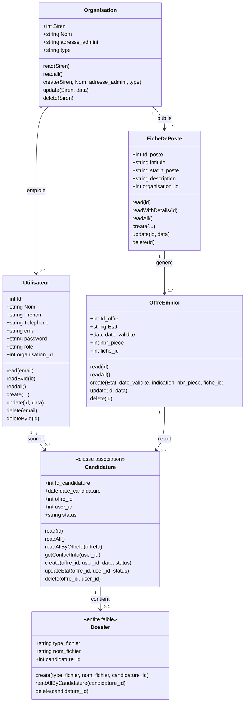
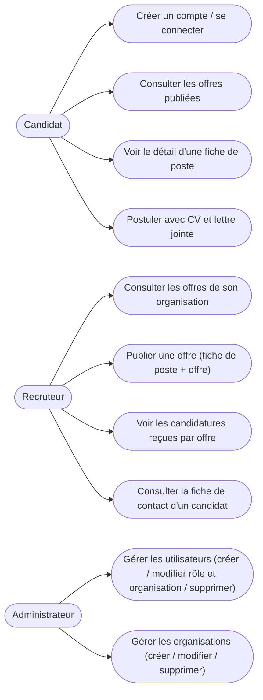

# Diagrammes UML — Plateforme de recrutement

## Diagramme de classes

Reflète le code réel de `src/models/` (attributs tirés de `db/schema.sql`, méthodes du code applicatif).

`Candidature` est modélisée comme une classe-association réalisant la relation many-to-many entre `Utilisateur` et `OffreEmploi` (contrainte `UNIQUE(offre_id, user_id)`). `Dossier` est une entité faible : elle n'a pas de clé primaire propre en base, et dépend entièrement de `candidature_id`.

`Id_poste` (FicheDePoste) et `Id_offre` (OffreEmploi) sont désormais auto-incrémentés (`AUTO_INCREMENT`), au même titre que `Utilisateur.Id` — nécessaire pour la création de fiche/offre côté recruteur sans génération manuelle d'identifiant.

> ✅ Bug corrigé : `OffreEmploi.create()` ne comptait que 6 placeholders SQL `?` pour 8 valeurs transmises, ce qui insérait une mauvaise valeur dans `fiche_id`. La méthode a été simplifiée (`Id_offre` auto-incrémenté retiré des paramètres, `nombre_candidature`/`date_publication` toujours fixés par le serveur) et est désormais utilisée par la route `POST /recruteur/nouvelle-offre`.

## Diagramme de cas d'utilisation

Cas d'utilisation groupés par rôle, reflétant l'état réel de l'application (routes et vues effectivement câblées, pas les modèles seuls).

